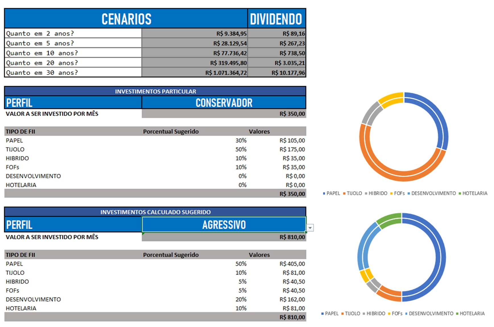

# Calculadora-investimentos-fiis-dio

Projeto desenvolvido em Excel para simular o acúmulo de patrimônio, dividendos mensais e a diversificação de aportes em Fundos Imobiliários (FIIs) conforme o perfil do investidor e diferentes horizontes de tempo[cite: 3].

---

## 1. Perguntas que a Ferramenta Responde e Onde Aparece Cada Resposta

Na aba **`Exercicio DIO 5`**, a planilha organiza as respostas em blocos objetivos:

| Pergunta de Negócio | Onde Aparece na Planilha (`Exercicio DIO 5`) |
| :--- | :--- |
| **Quanto sugerir de aporte com base no salário?** | Bloco **CONFIGURAÇÕES** → célula `D12` (`Sugestão de Investimento`, calculando `30%` do salário informado em `D10`). |
| **Qual será o patrimônio acumulado no prazo escolhido?** | Bloco **INVESTIMENTO MENSAL** → célula `D18` (`PATRIMONIO ACUMULADO?`), considerando o aporte mensal (`D15`), anos (`D16`) e taxa (`D17`). |
| **Quanto vou receber de dividendos mensais ao final do prazo?** | Bloco **INVESTIMENTO MENSAL** → célula `D19` (`DIVIDENDOS MENSAIS?`). |
| **Como o patrimônio e os dividendos evoluem em outros prazos?** | Bloco **CENARIOS** → intervalo `C22:D26`, exibindo patrimônio acumulado e dividendos mensais para **2, 5, 10, 20 e 30 anos**. |
| **Como dividir o aporte mensal entre os tipos de FIIs?** | Blocos **INVESTIMENTOS PARTICULAR** (`B32:D39`, usando o aporte definido pelo usuário) e **INVESTIMENTOS CALCULADO SUGERIDO** (`B45:D52`, usando a sugestão de `30%` do salário). |

---

## 2. Como `VF` e `PROCV` Entram nos Cálculos?

* **Função `VF` (`FV` — Valor Futuro):**
  * **Fórmula principal (`D18`):** `=VF(Taxa_Mensal; Anos*12; Investimento_Mensal)*-1`
  * **Cenários (`C22:C26`):** `=VF(Taxa_Mensal; $A22*12; Investimento_Mensal)*-1`
  * **Como funciona:** Calcula o montante acumulado ao final do período com aportes mensais constantes (`Investimento_Mensal`), convertendo os anos em meses (`Anos*12`) para alinhar com a taxa de rendimento mensal (`Taxa_Mensal`). O resultado é multiplicado por `-1` para converter o fluxo de saída padrão do Excel em um valor positivo de patrimônio.

* **Função `PROCV`  — Procurar Vertical):**
  * **Fórmula (`C33:C38` e `C46:C51`):** `=PROCV($C$29&"-"&B33; Matriz_Procv; 4; 0)`
  * **Como funciona:** Concatena o perfil selecionado (`$C$29` ou `$C$42`) com o tipo de FII da linha (`B33`, por exemplo `MODERADO-PAPEL`), busca essa chave exata (`0` / `FALSO`) na primeira coluna da tabela de referência na aba **`TB_RF_DIO_5`** e retorna a 4ª coluna (`Porcentual Sugerido`). Em seguida, a coluna `Valores` multiplica esse percentual pelo aporte mensal.

---

## 3. Intervalos Nomeados Criados

Para tornar as fórmulas mais legíveis e fáceis de auditar, foram definidos os seguintes nomes no Gerenciador de Nomes (`Exercicio DIO 5`):

* **`Salario`** (`$D$10`): Valor do salário mensal de exemplo (`R$ 2.700,00`).
* **`Rendimento_Carteira`** (`$D$11`): Taxa média de rendimento mensal esperada (`0,95%`).
* **`Sugestão_Salario`** (`$D$12`): Valor sugerido para investimento (`=Salario*30%`).
* **`Investimento_Mensal`** (`$D$15`): Aporte mensal definido pelo usuário (`R$ 350,00`).
* **`Anos`** (`$D$16`): Horizonte de investimento em anos (`8`).
* **`Taxa_Mensal`** (`$D$17`): Taxa mensal aplicada na projeção (`=Rendimento_Carteira`).
* **`Patrimonio_acumulado`** (`$D$18`): Resultado do valor futuro acumulado usado para calcular os dividendos mensais em `D19`.

---

## 4. Percentuais de Cada Perfil e de Onde Vieram

Os percentuais de alocação estão estruturados na aba **`TB_RF_DIO_5`** para seis categorias de FIIs (`PAPEL`, `TIJOLO`, `HIBRIDO`, `FOFs`, `DESENVOLVIMENTO` e `HOTELARIA`), baseados nos critérios de diversificação e tolerância a risco trabalhados no desafio da DIO, totalizando **100%** em cada perfil:

| Tipo de FII | Conservador | Moderado | Agressivo |
| :--- | :---: | :---: | :---: |
| **PAPEL** | 30% | 32% | 50% |
| **TIJOLO** | 50% | 40% | 10% |
| **HIBRIDO** | 10% | 8% | 5% |
| **FOFs** | 10% | 10% | 5% |
| **DESENVOLVIMENTO** | 0% | 10% | 20% |
| **HOTELARIA** | 0% | 0% | 10% |
| **Total** | **100%** | **100%** | **100%** |

* **Conservador:** Prioriza previsibilidade e fluxo de renda com forte peso em Tijolo (`50%`) e Papel (`30%`), zerando segmentos de maior risco como Desenvolvimento e Hotelaria.
* **Moderado:** Equilibra Tijolo (`40%`) e Papel (`32%`), abrindo espaço de `10%` para Desenvolvimento.
* **Agressivo:** Aumenta a exposição em fundos de Papel (`50%`) buscando maior retorno mensal, mantendo diversificação nos demais segmentos.

---

## 5. O Que Foi Mudado em Relação à Ferramenta do Expert

* **Dupla simulação de alocação:** Inclusão de dois blocos paralelos de distribuição por FIIs — **Investimentos Particular** (baseado no aporte livre do usuário) e **Investimentos Calculado Sugerido** (baseado automaticamente em `30%` do salário) — permitindo comparar o plano atual com o ideal sugerido.
* **Tabela de cenários temporais:** Adição do quadro **CENARIOS** (`2, 5, 10, 20 e 30 anos`) mostrando lado a lado o patrimônio acumulado e a renda passiva mensal projetada.
* **Uso de intervalos nomeados:** Padronização dos parâmetros principais com nomes descritivos (`Salario`, `Taxa_Mensal`, `Investimento_Mensal`, etc.) para eliminar referências soltas de células.

---

## 6. Evidências da Simulação (Dois Perfis)

### Simulação 1 — Perfil Conservador / Agressivo

### Simulação 2 — Perfil Moderado / Conservador 

